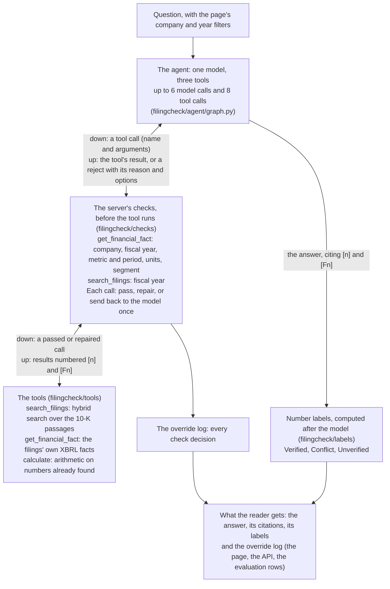

# FilingCheck

An agent that answers questions about 25 public companies' SEC 10-K filings, where the server checks every number lookup the model asks for before it runs, and every number in the answer is labeled against the filing's own data.


**Live demo: [filingcheck.vercel.app](https://filingcheck.vercel.app)** [](https://github.com/nazrulhuda/filingcheck/actions/workflows/ci.yml)

<!-- Video: the link to the two-minute demo goes here when it exists. -->

Built with Python, LangGraph, FastAPI, Postgres + pgvector, Next.js/TypeScript, Docker, GitHub Actions.

**What this project shows**

- A working agent with three typed tools, and a live demo.
- Six server-side checks on the model's number lookups and searches: each call is passed, repaired or rejected before it runs.
- A pre-registered, reproducible evaluation.

**By the numbers**

| Part | What it is |
|---|---|
| Data | 75 annual reports (10-Ks) from 25 companies, 3 years each, each pinned by its SEC accession number. |
| Search | 42,612 passages from Items 1, 1A, 7, 7A and 8 of each report, searched by meaning and by keyword. |
| Numbers | 13 financial metrics read from each filing's own XBRL data; 1,123 figures [cross-checked against the SEC's companyfacts file](docs/facts_report.md), 0 disagreements. |
| Agent | 3 tools (search, number lookup, exact calculator). |
| Checks | 6 server-side rules on the model's lookups, every decision logged and shown. |
| Testing | 3,855 test answers across 5 setups; every published number recomputed by one command. |
| CI gate | 24 scripted agent scenarios run the real agent, checks, lookup and grader with no model, in CI. |
| Reproduction | `make report` recomputes every published number from the committed rows, with no API key and no database. |

## Results

- **The same rules written into the model's prompt were more accurate than enforcing them on the server:** 85.2% against 75.5% accuracy (checks on minus prompt rules -9.7 points, 95% interval -16.4 to -3.0), at about two and a half times the cost per question, with no clear difference on confidently wrong answers (7.3% and 10.6%).
- **The pre-registered headline:** against no checks, the server checks cut confidently wrong answers from 18.5% to 10.6% (-7.9 points, 95% interval -12.7 to -3.6).
- **Where the checks failed:** of 90 failed checks-on runs read one by one, 23 came from gaps in the checks and 17 from a check's own action.
- **The noise is large:** 18% to 29% of the trap questions change outcome between runs of the same arm, which is why every difference comes with an interval.


Measured once on the 110 sealed held-out trap questions, 3 runs each, from the tagged commit `week6-measured`, by rules fixed in advance ([pre-registration](eval/PREREGISTRATION.md)). The search-only baseline's low confidently-wrong rate comes from abstaining often (on more than half the held-out questions). The [full report](eval/results/2026-11-14_final_report.md) has the development and control sets, the step-by-step differences, the error analysis, the graders' checks and the cost, and `make report` recomputes every number.

**How it is built** (the source is [docs/architecture.mmd](docs/architecture.mmd)):



[What works today](docs/what_works_today.md) lists each part, with its report.

**How one question goes through it**, from the saved example "How much revenue did Nike make last year?" (`web/data/examples.json`; the page shows it):

1. The model asked `get_financial_fact` for Nike's revenue for fiscal **2025**.
2. The fiscal-year check read "last year" as the latest annual report and **repaired** the year to 2026; its record reads: "'last year' read as the latest annual report; the model sent 2025; used fiscal 2026 (Jun 1, 2025 to May 31, 2026)". The company, metric, units and segment checks passed the call.
3. The tool returned the filing's own fact: `us-gaap:RevenueFromContractWithCustomerExcludingAssessedTax = 46398000000 USD, 2025-06-01 to 2026-05-31`, cited as [F1].
4. The answer, as stored: "Nike’s revenue for its most recent fiscal year (ended May 31, 2026) was **$46,398 million**【F1】. This figure covers the period from June 1, 2025 to May 31, 2026."
5. After the model, the labeler found $46,398 million in the cited fact F1 and labeled it **Verified**; the five check decisions are stored with the answer as its override log.

Built and measured between October 25 and November 2026, in seven stages that the documents call weeks (about three calendar weeks of work), by Nazrul Huda Shanto (New York). The measured commit is tagged `week6-measured`; the live API's `/health` shows the commit it runs.

## Known limits

- **One model was measured** (`gpt-oss-20b`), with one prompt for the prompt-rules arm, built by code from the checks' data; a better-written prompt might do better still.
- **The intervals are wide** for sets of this size (110 held-out questions); the noise between identical runs is large.
- **The checks miss phrasings they were not built for**, and some of their own actions cause failures.
- The checks cover the arguments of the tools, not the text of an answer.
- Verified means the number is in the answer's sources, not that the sentence is right: a Verified figure can be the wrong number for the question.
- **The graders are automatic:** a deterministic grader for numbers and an LLM grader for text, checked by two other automatic graders grading blind; the owner reviewed but did not grade blind. The LLM grader wrongly failed five held-out answers that gave a figure the filing states, with a citation, although the question's note accepts that.
- **The gold values come from the same lookup the agent uses**, cross-checked against the SEC's companyfacts.
- In an answer with a calculation, a figure the model writes again in its working (for example "130,497 M") is labeled Unverified, because the labeler reads figures as written.

[All known limits](docs/known_limits.md)

## Not built

- The gaps in the checks found in the error analysis (the phrasings they do not read, the year the number tool keeps when the question names none, the calendar-year asks) are not fixed.
- An arm with the rules in the prompt and the checks together; a stronger model; questions written by a person; search over tables; a reranker.
- A changed system needs new sealed questions and a new pre-registration, because the held-out questions have now been seen.

## How to run

Needs [uv](https://docs.astral.sh/uv/), GNU make and Docker, and Node 24 for the web page. On Windows, run the commands from Git Bash, and keep the clone outside the Temp folder: Windows can block programs there, including the pre-commit hook. Copy `.env.example` to `.env` and put your contact email in `SEC_CONTACT_EMAIL` (the SEC requires one on every request). Searching needs `OPENAI_API_KEY` and answering needs `OPENROUTER_API_KEY` (gpt-oss-20b through OpenRouter, on Groq's servers); `GEMINI_API_KEY` is the fallback model's.

```bash
make setup    # install Python 3.12, the dependencies and the pre-commit hooks
make db-up    # start the local Postgres + pgvector database
make ingest   # download the filings, split and chunk them, and load the database
make embed    # embed the passages (prints the plan and its cost, then asks)
make run      # the API on http://localhost:8000
cd web && npm ci && npm run dev   # the page on http://localhost:3000
```

`make lint` and `make test` run the same checks as CI; `make test-integration` runs the database tests against the local database from `make db-up`. In `web/`, `npm run lint`, `npm run typecheck` and `npm test` do the same for the page.

## Reproduce the results

```bash
make setup     # uv sync and the pre-commit hooks (needs uv and GNU make; about two minutes)
make report    # recomputes the report, its per-run CSV and the charts (under a minute)
```

`make report` recomputes every published number from the committed rows, with no API key and no database. `make verify-measured` (also in CI) fails if the measured code or data or the pre-registration's definitions differ from the tagged commit, or if the final rows and grades differ from the commit that merged them.

## Related work

- **VeriFin: A Neurosymbolic Framework for Verifying LLM-Generated Financial Claims** ([arXiv:2608.10213](https://arxiv.org/abs/2608.10213))
- **FinVerBench: Benchmark Validity and Calibration in Large Language Model Financial Statement Verification** ([arXiv:2605.29586](https://arxiv.org/abs/2605.29586))
- **FinanceBench: A New Benchmark for Financial Question Answering** ([arXiv:2311.11944](https://arxiv.org/abs/2311.11944), CC BY-NC 4.0): its 150 public questions cover filings from 2015 to 2023, which are outside this dataset. The "normal" question set here is instead written in FinanceBench's three question styles (metrics-generated, domain-relevant and novel-generated) about the pinned filings, with FinanceBench credited as the template.

The number-verification layer here builds on the first two. Tool-argument guardrails also exist in agent frameworks such as the OpenAI Agents SDK. What this project adds is server-side *repair* of arguments using domain data, plus measurement.
