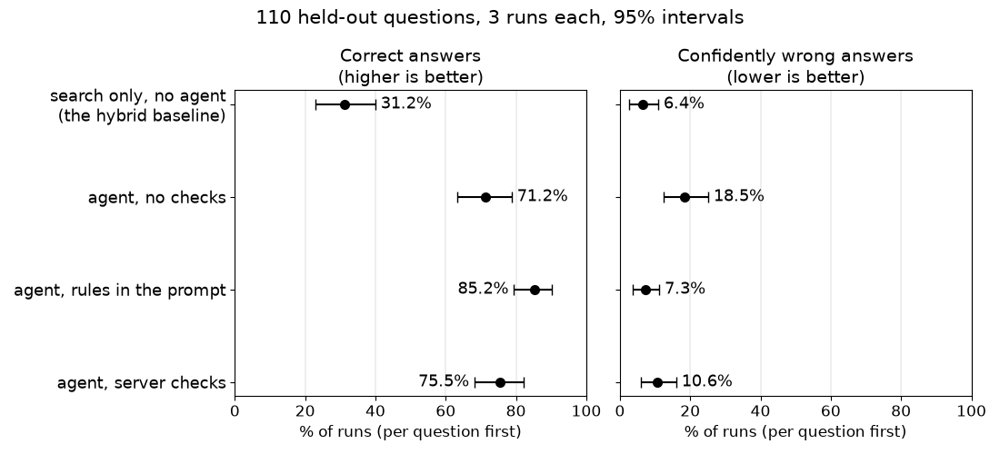
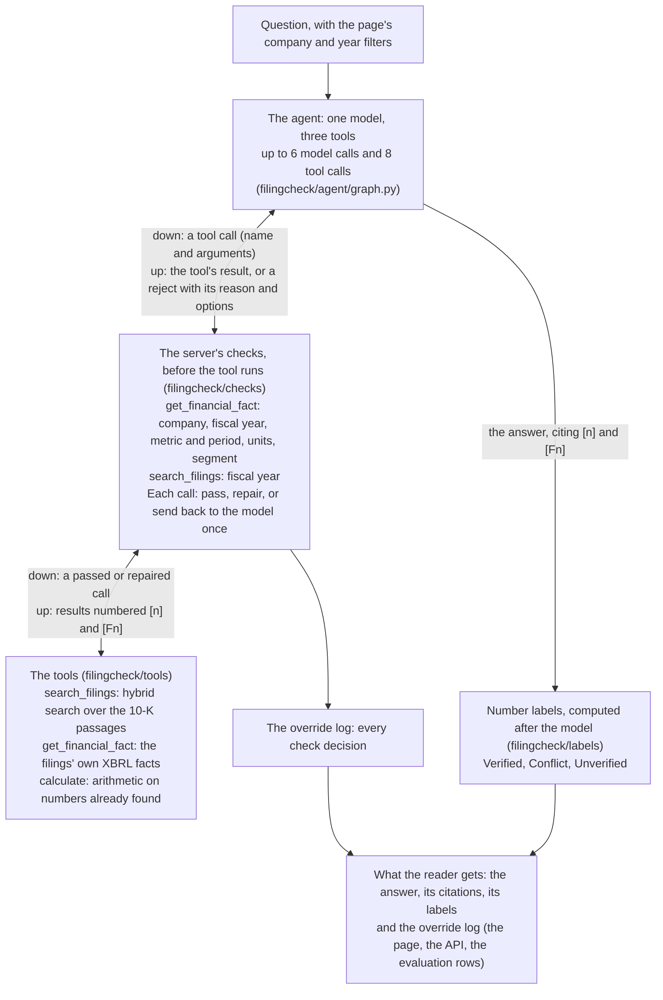
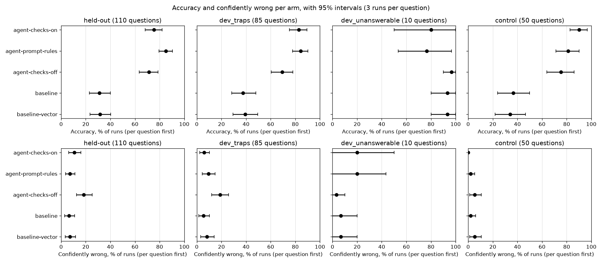

# FilingCheck

An agent that answers questions about 25 public companies' SEC 10-K filings, where the server checks every number lookup the model asks for before it runs, and every number in the answer is labeled against the filing's own data.


**Live demo: [filingcheck.vercel.app](https://filingcheck.vercel.app)** [](https://github.com/nazrulhuda/filingcheck/actions/workflows/ci.yml)

<!-- Video: the link to the two-minute demo goes here when it exists. -->

Built with Python, LangGraph, FastAPI, Postgres + pgvector, Next.js/TypeScript, Docker, GitHub Actions.

**What this project shows**

- A working agent with three typed tools, and a live demo.
- Six server-side checks on the model's number lookups and searches: each call is passed, repaired or rejected before it runs.
- A pre-registered, reproducible evaluation.

**By the numbers**

| Part | What it is |
|---|---|
| Data | 75 annual reports (10-Ks) from 25 companies, 3 years each, each pinned by its SEC accession number. |
| Search | 42,612 passages from Items 1, 1A, 7, 7A and 8 of each report, searched by meaning and by keyword. |
| Numbers | 13 financial metrics read from each filing's own XBRL data; 1,123 figures cross-checked against the SEC's companyfacts file, 0 disagreements. |
| Agent | 3 tools (search, number lookup, exact calculator). |
| Checks | 6 server-side rules on the model's lookups, every decision logged and shown. |
| Testing | 3,855 test answers across 5 setups; every published number recomputed by one command. |
| Coverage | 915 of 975 company-year metric values are in the filings' data; for the rest the number tool answers "unavailable" and derives nothing ([coverage](docs/facts_coverage.md)). |
| Not compared | 18 figures had no companyfacts entry to compare, all from S&P Global's fiscal 2024 filing ([facts report](docs/facts_report.md)). |
| CI gate | 24 scripted agent scenarios run the real agent, checks, lookup and grader with no model, in CI. |
| Reproduction | `make report` recomputes every published number from the committed rows, with no API key and no database. |

**The result** (110 sealed held-out trap questions, 3 runs each, scored by rules fixed in advance; [full report](eval/results/2026-11-14_final_report.md)):

- **The same rules written into the model's prompt were more accurate than enforcing them on the server.** The checks are six rules the server applies before a tool runs: five on each number lookup the model requests (the company, the fiscal year, the metric and period, the units, the segment) and one on each search (the fiscal year); they repair what the question settles and send the rest back to the model. Written into the prompt instead, with no checks, the same rules scored 85.2% against 75.5% accuracy, at about two and a half times the cost per question, with no clear difference on confidently wrong answers (7.3% and 10.6%).
- **The pre-registered headline:** against no checks, the server checks cut confidently wrong answers from 18.5% to 10.6% (95% interval of the difference -12.7 to -3.6 points).
- **How it was measured:** once, on sealed questions, by rules fixed in advance (`eval/PREREGISTRATION.md`), from the tagged commit `week6-measured`; reproducible with `make report`, with no API key and no database.



**How it is built** (the source is [docs/architecture.mmd](docs/architecture.mmd)):



**How one question goes through it**, from the saved example "How much revenue did Nike make last year?" (`web/data/examples.json`; the page shows it):

1. The model asked `get_financial_fact` for Nike's revenue for fiscal **2025**.
2. The fiscal-year check read "last year" as the latest annual report and **repaired** the year to 2026; its record reads: "'last year' read as the latest annual report; the model sent 2025; used fiscal 2026 (Jun 1, 2025 to May 31, 2026)". The company, metric, units and segment checks passed the call.
3. The tool returned the filing's own fact: `us-gaap:RevenueFromContractWithCustomerExcludingAssessedTax = 46398000000 USD, 2025-06-01 to 2026-05-31`, cited as [F1].
4. The answer, as stored: "Nike’s revenue for its most recent fiscal year (ended May 31, 2026) was **$46,398 million**【F1】. This figure covers the period from June 1, 2025 to May 31, 2026."
5. After the model, the labeler found $46,398 million in the cited fact F1 and labeled it **Verified**; the five check decisions are stored with the answer as its override log.

Built and measured between October 25 and November 2026, in seven stages that the documents call weeks (about three calendar weeks of work), by Nazrul Huda Shanto (New York). The measured commit is tagged `week6-measured`; the live API's `/health` shows the commit it runs.

## What the measurement showed

1. **Telling the model the rules did better than enforcing them.** On the held-out questions, the prompt-rules arm was more accurate than the checks-on arm (85.2% against 75.5%; checks on minus prompt rules -9.7 points, 95% interval -16.4 to -3.0), with no clear difference on confidently wrong answers (report, sections 1 and 3).
2. **The checks cut confidently wrong answers**, against no checks: 18.5% to 10.6% (-7.9 points, -12.7 to -3.6); both held-out files point the same way, and the development traps too (section 1).
3. **Where the checks failed:** of 90 failed checks-on runs read one by one, 23 came from gaps in the checks (phrasings they do not read; a year the model chose when the question named none) and 17 from a check's own action (asking which fiscal year where the question's writer accepted the nearest one) (section 10).
4. **The graders need checking too:** 30 text verdicts graded blind by two other automatic graders agreed with the LLM grader on 28 and 27 of 30; the LLM grader wrongly failed five cited answers that the questions' notes accept (sections 9 and 10).
5. **The noise is large:** 18% to 29% of the trap questions change outcome between runs of the same arm, which is why every difference comes with an interval (section 7).

## Results

The week 6 measurement, run once on 2026-11-14 from the tagged commit `week6-measured`, scored by the rules in `eval/PREREGISTRATION.md`. Rates are per question first, then averaged; every difference is paired by question, with a 95% bootstrap interval. Held-out is both sealed files together (110 scored questions, 3 runs each).

**The same rules written into the prompt did better than the server-side checks on accuracy.** On the held-out questions, the agent with the checks off and the checks' rules written into its system prompt answered 85.2% correctly, against 75.5% with the checks on (checks on minus prompt rules -9.7 points, 95% interval -16.4 to -3.0). On confidently wrong answers there was no clear difference (7.3% with the prompt rules, 10.6% with the checks; +3.3 points, -0.9 to +8.2). The prompt costs about two and a half times as much per question, because the rules make it long. The checks add enforcement that does not depend on the model following instructions, and a log of every decision; on these questions that did not make the answers more accurate than telling the model the rules. On the development traps there was no clear difference on either measure.

**The pre-registered headline:** On 110 held-out trap questions (3 runs each), turning the checks on changed the confidently-wrong rate from 18.5% to 10.6% (difference -7.9 points, 95% interval -12.7 to -3.6). The interval lies below zero, so the reduction is claimed. Both held-out files point the same way (-11.9 points on the first 28, -6.5 on the other 82). On the development traps, which the checks were built while looking at, the difference is -12.9 points (-20.0 to -6.7); the two are not pooled, because the development estimate lies just outside the held-out interval. Accuracy with the checks on rose 4.2 points on held-out (-0.3 to +8.8, not clear of zero). Wrong-argument calls fell from 15.8 to 7.6 per 100 runs, partly by design: with the checks on, a stopped call never runs. On the 50 control questions no check repaired or rejected a number call, and accuracy rose 14.7 points (+5.3 to +24.7).

Held-out (110 questions):

| Arm | Accuracy | Confidently wrong | Wrong-argument calls per 100 runs | Abstain rate |
|---|---:|---:|---:|---:|
| baseline, vector search | 31.5% | 7.3% | n/a | 57.3% |
| baseline, hybrid search | 31.2% | 6.4% | n/a | 56.4% |
| agent, checks off | 71.2% | 18.5% | 15.8 | 4.2% |
| agent, checks off, rules in the prompt | 85.2% | 7.3% | 5.5 | 1.2% |
| agent, checks on | 75.5% | 10.6% | 7.6 | 4.5% |
| always abstain (floor) | 30.0% | 0.0% | - | - |

Development traps (85 questions; the checks were built while looking at these):

| Arm | Accuracy | Confidently wrong | Wrong-argument calls per 100 runs | Abstain rate |
|---|---:|---:|---:|---:|
| baseline, vector search | 39.2% | 8.2% | n/a | 41.2% |
| baseline, hybrid search | 37.6% | 5.5% | n/a | 43.9% |
| agent, checks off | 69.4% | 18.8% | 12.5 | 5.5% |
| agent, checks off, rules in the prompt | 84.3% | 9.4% | 3.5 | 4.3% |
| agent, checks on | 82.7% | 5.9% | 3.1 | 5.1% |
| always abstain (floor) | 29.4% | 0.0% | - | - |

The baselines' low confidently-wrong rate comes from abstaining often (on more than half the held-out questions); always abstaining scores 30.0% on held-out with no confidently wrong answers.



Step by step on held-out (difference in points, 95% interval):

| Step | Accuracy | Confidently wrong |
|---|---:|---:|
| baseline, vector → hybrid search | -0.3 (-4.2 to +3.6) | -0.9 (-4.8 to +3.0) |
| baseline → agent, checks off | +40.0 (+29.1 to +50.6) | +12.1 (+5.8 to +18.8) |
| checks off → rules in the prompt | +13.9 (+7.0 to +20.9) | -11.2 (-16.4 to -6.7) |
| checks off → checks on | +4.2 (-0.3 to +8.8) | -7.9 (-12.7 to -3.6) |
| checks on, labels not counted → counted | - | -0.6 (-1.5 to +0.0) |

**Noise:** for the agent arms on the trap sets, 18% to 29% of questions do not get the same outcome in all three runs; a difference of a few points between two arms is within that. **The graders:** 30 text verdicts were graded blind by two other automatic graders; the LLM grader agreed with them on 28 and 27 of 30. **Cost:** about $2.09 billed for the week ([notes](docs/week6_notes.md)).

The [full report](eval/results/2026-11-14_final_report.md) has every set, the per-run CSV, the check activity, the error analysis and the graders' checks.

## Known limits

- **The intervals are wide** for sets of this size (110 held-out questions); the noise between identical runs is large.
- **One model was measured** (`gpt-oss-20b`), with one prompt for the prompt-rules arm, built by code from the checks' data; a better-written prompt might do better still.
- **The checks miss phrasings they were not built for**, and some of their own actions cause failures. Of 90 failed checks-on runs read one by one, 23 came from gaps (the number tool keeps a year the model chose when the question names none; "last yr", "morgans", "american", "uniteds", "standard and poors" and "Citizens" are not read; `search_filings` has no company check) and 17 from a check's own action (asking which fiscal year for a calendar year where the question's writer accepted the nearest one; reading "the year before last" one year too far).
- **The graders are automatic:** a deterministic grader for numbers and an LLM grader for text, checked by two other automatic graders grading blind; the owner reviewed but did not grade blind. The LLM grader wrongly failed five held-out answers that gave a figure the filing states, with a citation, although the question's note accepts that. The text samples hold many easy rows.
- **The decline rule reads the checks' own refusal wordings** (widened before the final run); a refusal in other words can still be graded as an answer (listed in the report).
- **`search_filings` searches passages, not tables**, so a figure that only a table states cannot be found by search.
- **The gold values come from the same lookup the agent uses**, cross-checked against the SEC's companyfacts.
- **The development traps were written alongside the checks**, so their results are not evidence.
- The control questions were used during development: the fiscal-year check on searches was built after a dry run on them (decisions, Nov 12), so the rise in control accuracy is not held-out evidence.
- In an answer with a calculation, a figure the model writes again in its working (for example "130,497 M") is labeled Unverified, because the labeler reads figures as written.
- **Latency is from batch mode**, and the PC slept during one arm, so one run's time includes the sleep (reported apart). The live page's fallback answers, given when the main model is rate-limited, were not measured. A reranker was never built or measured.
- The checks cover the arguments of the tools, not the text of an answer. A text answer is not compared with the passage it cites, so it can be confidently unsupported: one answer gave a reason for a Goldman Sachs decision that the filing does not give, and a saved example calls Walmart's currency swaps "10-year-old", which the filing does not say. In the Week 5 dry run, a third or more of the text answers to normal questions said more than their cited passages support, and sending searches to the latest filing did not change that.
- On questions the filings do not answer (a reason a filing never gives), searching the right filing makes the model answer more often, not less: with the checks on it answered more of the 10 unanswerable questions in the final run too.
- The model sometimes says it can't find the answer without searching at all.
- A number's chip can show the metric's standard line name instead of the company's own wording ("Revenues" for Verizon's "Total Operating Revenues").
- Verified means the number is in the answer's sources, not that the sentence is right: a Verified figure can be the wrong number for the question.

## What works today

- **75 filings, pinned and checked:** the last three 10-Ks of 25 companies, pinned by accession number, split into sections and 42,612 passages, and checked by `make verify-data` ([data report](docs/data_report.md), [spot check](docs/spot_check.md), [week 1 summary](docs/week1_summary.md)).
- **Hybrid search, measured:** vector, keyword and hybrid search over the passages, scored on 40 questions with and without a company and year filter. Hybrid search did not beat vector search on these questions, and the report says so ([retrieval report](docs/retrieval_report.md)).
- **Baseline answers with citations:** plain retrieval-augmented answers from one model call, asked to cite every claim to its passage; an answer with an uncited figure is flagged. They are not checked, and on the example trap questions they guess the company or the year, or decline to answer ([baseline answers](docs/baseline_examples.md)).
- **The API:** a FastAPI service that answers or streams questions, keeps a request log, and limits questions per address and per day; it runs in a Docker image ([filingcheck/app](filingcheck/app/)).
- **The web page:** a Next.js page that asks the agent with its checks on and shows each tool step as it runs, a chip for each cited passage or number (a number's chip opens to the value as filed, its period and the SEC document), a "What was checked" panel, and seven saved example answers ([web](web/)).
- **The numbers and the agent:** company totals from each filing's own XBRL facts, cross-checked against the SEC's companyfacts; three tools with typed inputs (`search_filings`, `get_financial_fact`, `calculate`); and an agent that chooses between them and cites the passages and facts it used. It runs on the page, from the command line (`make ask MODE=agent`) and from the API (`mode: "agent"`) ([facts report](docs/facts_report.md), [metric coverage](docs/facts_coverage.md), [week 3 summary](docs/week3_summary.md)).
- **Skeptical checks on the tools:** before `get_financial_fact` runs, five checks compare its arguments with the question's words and the SEC data: the company, the fiscal year (including "last year"), the metric and period, the units and the segment. Before `search_filings` runs, the fiscal-year check does the same for its year, and sends a search that names no year to the company's latest filing. Each passes the call, repairs it when the question settles the answer, or sends it back to the model with the options, once. Every decision, passes included, goes into an override log that is kept with each answer, in the request log and in the evaluation rows ([week 4 summary](docs/week4_summary.md)).
- **Graders:** a deterministic grader for numbers, and an LLM grader for text answers and for a second opinion on number grades (on the failed ones in the development runs, on every number-graded run in the final run) ([eval](eval/README.md)). The LLM grader was checked on two samples of 40 stored answers, each graded blind by other automatic graders. On the second sample, after one fix to its prompt, it agreed with the first blind grader on 37 of 40 verdicts; on a later sample of 20 text answers, 16 of 20. In the final run, 30 text verdicts drawn by seed were graded blind by two other automatic graders: the LLM grader agreed with them on 28 and 27 of 30. The owner reviewed the grades on ten rows.
- **Two sealed held-out trap files** (112 questions, 110 scored; `eval/questions/heldout_traps.jsonl` and `heldout_traps_2.jsonl`). Both were sealed by SHA-256 before the final run and run once from the tagged commit.
- **The measurement:** a pre-registration (`eval/PREREGISTRATION.md`) merged before the first final row was written; five arms on five question sets, 3 runs each (3,855 rows); `make report` computes every number from the committed rows ([full report](eval/results/2026-11-14_final_report.md)).
- **Number labels:** every figure in an answer is labeled Verified (it is in a cited fact or passage), Conflict (it differs from the cited fact) or Unverified, after the model answers and without changing what it wrote; the page shows the label next to each figure ([labels](filingcheck/labels/), [week 5 summary](docs/week5_summary.md)).
- **A deterministic gate in CI:** 24 scripted scenarios run the real agent, checks, lookup and grader with no model, and fail the build if a check's decision changes (`make eval-smoke`, [eval](eval/README.md)).

## Not built

- The gaps in the checks found in the error analysis (the phrasings they do not read, the year the number tool keeps when the question names none, the calendar-year asks) are not fixed.
- An arm with the rules in the prompt and the checks together; a stronger model; questions written by a person; search over tables; a reranker.
- A changed system needs new sealed questions and a new pre-registration, because the held-out questions have now been seen.

## How to run

Needs [uv](https://docs.astral.sh/uv/), GNU make and Docker, and Node 24 for the web page. On Windows, run the commands from Git Bash, and keep the clone outside the Temp folder: Windows can block programs there, including the pre-commit hook. Copy `.env.example` to `.env` and put your contact email in `SEC_CONTACT_EMAIL` (the SEC requires one on every request). Searching needs `OPENAI_API_KEY` and answering needs `OPENROUTER_API_KEY` (gpt-oss-20b through OpenRouter, on Groq's servers); `GEMINI_API_KEY` is the fallback model's.

```bash
make setup    # install Python 3.12, the dependencies and the pre-commit hooks
make db-up    # start the local Postgres + pgvector database
make ingest   # download the filings, split and chunk them, and load the database
make embed    # embed the passages (prints the plan and its cost, then asks)
make run      # the API on http://localhost:8000
cd web && npm ci && npm run dev   # the page on http://localhost:3000
```

`make lint` and `make test` run the same checks as CI; `make test-integration` runs the database tests against the local database from `make db-up`. In `web/`, `npm run lint`, `npm run typecheck` and `npm test` do the same for the page.

## Reproduce the results

```bash
make setup     # uv sync and the pre-commit hooks (needs uv and GNU make; about two minutes)
make report    # recomputes the report, its per-run CSV and the charts (under a minute)
```

No API key and no database are needed: `make report` reads the committed answers and grades (`eval/results/2026-11-14_*-final.jsonl` and `_llm.jsonl`) and writes `eval/results/2026-11-14_final_report.md`, the CSV beside it and the charts in `docs/results/`. Afterwards `git diff` shows no change in the report or any CSV; that is what the `reproduce` job in CI checks on every push (the chart images are redrawn, not compared, because their bytes depend on the machine's fonts). This proves that every number in the report, and so in this README, is computed from the committed answers and grades by the committed code.

It does not ask the model again. Re-running the answers (`make eval`) costs about $2 and gives slightly different rows, because the model runs at temperature 0.6. The run itself is checked another way: the pre-registration's SHA-256, the two held-out files' seals and the tagged commit `week6-measured` are recorded in `eval/results/2026-11-14_final-run_record.md`, and every row records that commit and its question file's hash. `make verify-measured` (also in CI) fails if any of the measured code or data differs from the tag's commit (`da7a451`, recorded in the code, so a moved tag fails too), or if any of the 50 final row and grade files differs from the commit that merged them (`4082c4e`), or if a new file appears under those names.

## Related work

- **VeriFin: A Neurosymbolic Framework for Verifying LLM-Generated Financial Claims** ([arXiv:2608.10213](https://arxiv.org/abs/2608.10213))
- **FinVerBench: Benchmark Validity and Calibration in Large Language Model Financial Statement Verification** ([arXiv:2605.29586](https://arxiv.org/abs/2605.29586))
- **FinanceBench: A New Benchmark for Financial Question Answering** ([arXiv:2311.11944](https://arxiv.org/abs/2311.11944), CC BY-NC 4.0): its 150 public questions cover filings from 2015 to 2023, which are outside this dataset. The "normal" question set here is instead written in FinanceBench's three question styles (metrics-generated, domain-relevant and novel-generated) about the pinned filings, with FinanceBench credited as the template.

The number-verification layer here builds on the first two. Tool-argument guardrails also exist in agent frameworks such as the OpenAI Agents SDK. What this project adds is server-side *repair* of arguments using domain data, plus measurement.
